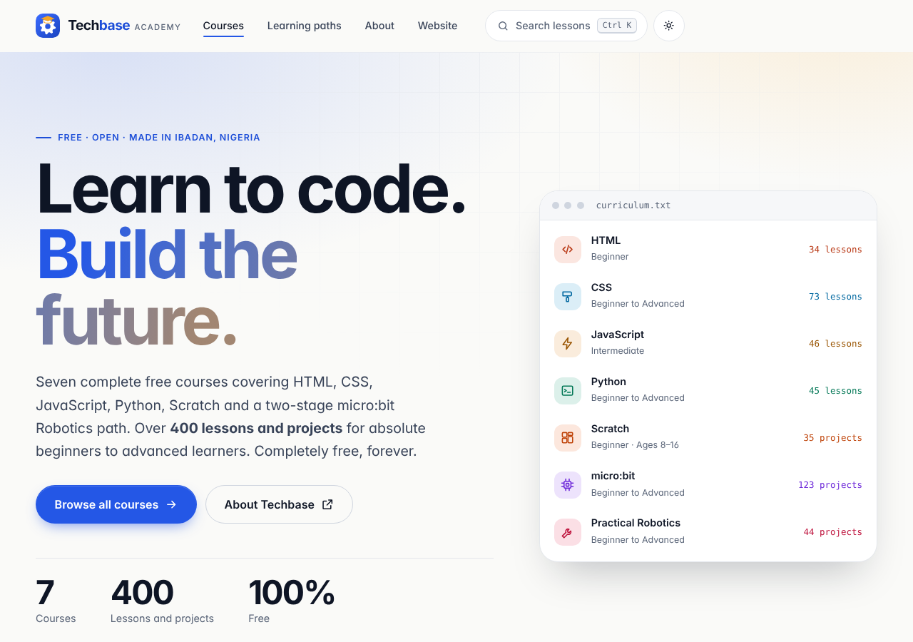

<div align="center">


# Techbase Consultant Services

**Empowering youth for the digital future through STEM excellence.**

[](https://github.com/techbaseng/techbaseng.github.io/actions/workflows/deploy.yml)
[](LICENSE)

[Website](https://techbaseng.github.io) · [Free Academy](https://techbaseng.github.io/learn/) · [Contact](https://techbaseng.github.io/contact/) · [Report an issue](../../issues/new/choose)

</div>



## About

Techbase Consultant Services is a STEM education and technology consultancy in Moniya, Ibadan, Nigeria. We work with schools, organisations and individuals on coding and robotics training for ages 8 to adult, curriculum and teaching aids, website and mobile app development, and AI tools for education.

This repository is the Techbase website. It also contains the **Techbase STEM Academy**: 472 free lessons across eight courses.

## What is on the site

- **Services**, **About**, **Team**, **Portfolio** of programmes we have run, **Blog**, **FAQ**, **Careers** and **Contact** pages.
- **Techbase Academy** (`/learn/`): free courses in HTML, CSS, JavaScript, Python, Scratch, micro:bit robotics, Practical Robotics and Android app development. Create a free account to unlock every lesson and keep your progress on all your devices. The first lesson of each course is open to everyone.
- Search the whole site with Ctrl + K (or `/`), light and dark themes, and pages that you have opened keep working offline.

## Academy courses

| Course | Lessons | Level |
|---|---|---|
| [HTML Fundamentals](https://techbaseng.github.io/techbase-html/) | 34 | Beginner |
| [CSS Styling](https://techbaseng.github.io/techbase-css/) | 73 | Beginner to Advanced |
| [JavaScript](https://techbaseng.github.io/techbase-js/) | 46 | Intermediate |
| [Python Programming](https://techbaseng.github.io/techbase-python/) | 45 | Beginner to Advanced |
| [Scratch Programming](https://techbaseng.github.io/techbase-scratch/) | 35 | Beginner, ages 8 to 16 |
| [Micro:bit Fundamentals (Stage 1)](https://techbaseng.github.io/techbase-robotics/) | 123 | Beginner to Advanced |
| [Practical Robotics (Stage 2)](https://techbaseng.github.io/techbase-practical-robotics/) | 44 | Beginner to Advanced |
| [Google Android Studio](https://techbaseng.github.io/techbase-android/) | 72 | Beginner to Advanced |

Video walkthroughs are on the [Techbase YouTube channel](https://www.youtube.com/@techbasengr).

## Built with

- A static site generated with Python (Jinja2, Beautiful Soup, Pygments, Pillow)
- Plain HTML, CSS and JavaScript in the browser, with no framework and self-hosted fonts
- Firebase Authentication and Firestore for accounts, saved progress and the enquiry forms
- GitHub Actions and GitHub Pages for building and hosting

## Repository layout

```
content/      Company pages, blog posts, photos, course details and every lesson source file
templates/    Page layouts
assets/       Stylesheets, scripts, fonts, logo, icons and partner logos
src/auth/     Sign-in and progress-sync code (bundled during the build)
firebase/     Database security rules
build/        The site generator and the quality checks
tests/        Browser tests for accounts and forms
docs/         Guides for the site owner
.github/      Automated build, deploy and security workflows
```

## Contributing

Spotted a typo or a broken lesson? [Open an issue](../../issues/new/choose) or edit the file on GitHub and open a pull request. See [CONTRIBUTING.md](CONTRIBUTING.md).

## Security

Please report vulnerabilities privately, as described in [SECURITY.md](SECURITY.md).

## Licence and credits

Released under the [MIT License](LICENSE). Scratch projects follow the Raspberry Pi Foundation curriculum, micro:bit projects come from [microbit.org](https://microbit.org), and Practical Robotics follows the Freenove Ultimate Starter Kit for micro:bit (FNK0045); each lesson links to its source. Fonts: Inter, Bricolage Grotesque and JetBrains Mono (SIL Open Font License). Icons: [Lucide](https://lucide.dev) (ISC) and [Simple Icons](https://simpleicons.org) (CC0).

## Contact

Techbase Consultant Services, Moniya, Ibadan, Oyo State, Nigeria · +234 812 690 9498 · techbasengr@gmail.com
